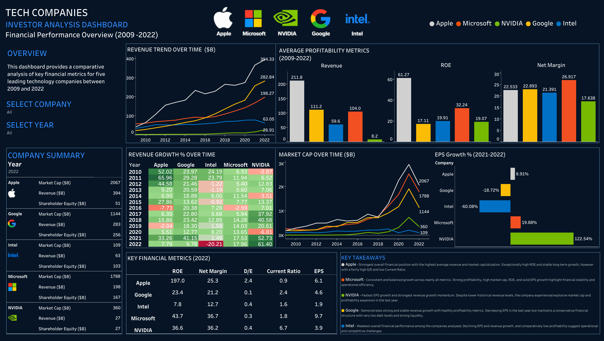
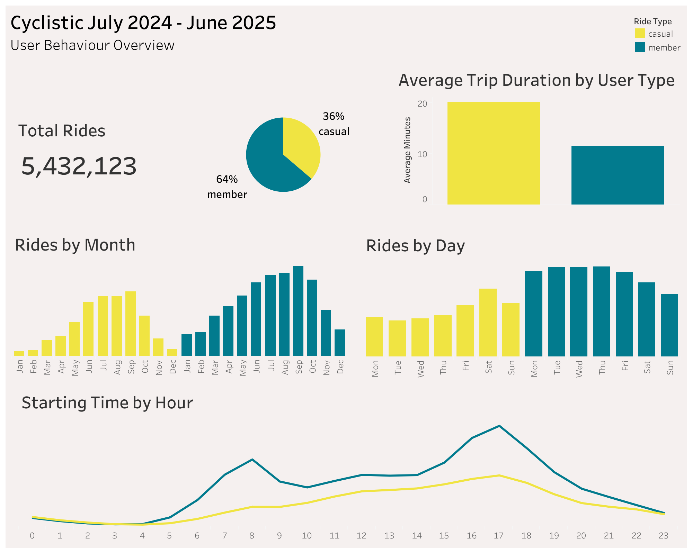

# 📊 André Bergvind | Projects Portfolio

👋 Hi, I'm André Bergvind

Business Graduate | Google Data Analytics Certificate Holder

This portfolio contains projects that demonstrate my approach to business analysis, problem-solving, and decision-making across different industries and business contexts.

## Featured Projects

📦 Inventory Management System • 📈 Financial Analysis • 🚚 Operations Analysis • 🚲 Consumer Behaviour Analysis • 

---
## 📦 Inventory Management System

### A command-line Python application for storing and tracking inventory items.

**Objective:**
Facilitate inventory management.
Provide a lightweight, error-handled tool to manage store or warehouse inventory, monitor total value, and prevent stockouts.

**Skills Demonstrated:**
Python • Data Structures (Dictionaries) • Input Validation • CLI Application Design • Inventory Control

🔗 [Project Repository](https://github.com/andrebergvind/inventory-management-system)

---
## 📈 Big Tech Financial Analysis

  

### A financial analysis of five major tech companies and their performance between 2009 and 2022

**Objective:**
Provide insights to support investment decision-making.

**Skills Demonstrated:**
Data Cleaning • Financial Analysis • SQL • Data Visualisation • Financial Decision-Making

🔗 [Tableau Dashboard](https://public.tableau.com/views/TechCompaniesFinancialAnalysis/Dashboard1?:language=en-GB&:sid=&:redirect=auth&:display_count=n&:origin=viz_share_link) 🔗 [Project Repository](https://github.com/andrebergvind/big-tech-financial-analysis.git) 

---
## 🚚 Glovo Delivery Performance Analysis
  

### An operations and logistics data analysis project analysing delivery performance data from Glovo

**Business Goal:**
Identify patterns associated with late deliveries and support operational improvements.

**Skills Demonstrated:**
Data Cleaning • SQL • Operational Analysis • Data Visualisation

🔗 [Tableau Dashboard](https://public.tableau.com/views/GlovoE-CommerceAnalysis/Dashboard1?:language=en-GB&:sid=&:redirect=auth&:display_count=n&:origin=viz_share_link) 
🔗 [Project Repository](https://github.com/andrebergvind/glovo-delivery-performance-analysis.git)

---
## 🚲 Cyclistic Bike Share Analysis

### A consumer behaviour data analysis project, part of the Google Data Analytics course

**Business Goal:**
Convert casual riders into annual members.

**Skills Demonstrated:**
Data Cleaning • SQL • Data Visualisation • Behavioural Analysis

🔗 [Tableau Dashboard](https://public.tableau.com/views/CyclisticAnalysis_17737226068460/UserBehaviourOverview?:language=en-GB&:sid=&:display_count=n&:origin=viz_share_link)  🔗 [Project Repository](https://github.com/andrebergvind/Cyclistic-bike-share-analysis) 

---
## 📫 Contact

💼 [LinkedIn](https://www.linkedin.com/in/andrebergvind/) | 
📊 [Tableau Public](https://public.tableau.com/app/profile/andr.bergvind/vizzes) | 
✍️ [Medium](https://medium.com/@andrebergvind)
